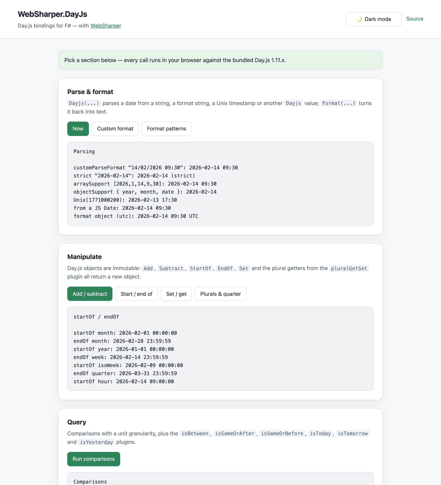

# WebSharper.DayJs

[](https://www.nuget.org/packages/WebSharper.DayJs)

WebSharper bindings for [Day.js](https://day.js.org/) 1.11.x — a fast, 2 kB,
immutable date library with a Moment.js-compatible API — for F# and C# web apps.

The binding consumes the npm package [`dayjs`](https://www.npmjs.com/package/dayjs)
as an ES module (`import dayjs from "dayjs"`) and is bundled by your toolchain
(esbuild in the sample); there is no CDN `<script>` tag. Plugins are imported
from their own modules (`dayjs/plugin/<name>`) and locales from
`dayjs/locale/<name>`, so only what you use ends up in the bundle.

This repository contains:

| Project | Purpose |
| --- | --- |
| `WebSharper.DayJs` | The binding: typed F#/C# wrappers for the Day.js core API, all 37 plugins, the locale registry and the bundled locales. |
| `WebSharper.DayJs.Sample` | A WebSharper SPA (esbuild → `dist/`) that exercises the whole surface: parsing/formatting, manipulation, queries, differences and relative time, UTC and timezones, locales, durations, object/array support, `minMax` and the calendar plugin. |

## Live demos

**Try it live:** [Open the sample in your browser](https://dotnet-websharper.github.io/dayjs/)



The sample doubles as the binding's [test case](#running-the-test-case): it
runs every headline API in the browser — `Dayjs(...)` parsing (string, format
string, strict, array, object, Unix timestamp, `Date`, format object),
`Format`/`Add`/`Subtract`/`StartOf`/`EndOf`/`Set`/`Get`, the plural getters and
`quarter`/`week`/`isoWeek`, the query methods (`IsBefore`/`IsSame`/`IsAfter`,
`IsBetween`, `IsSameOrAfter`/`IsSameOrBefore`, `IsToday`/`IsTomorrow`/
`IsYesterday`, `IsLeapYear`), `Diff` and the relative-time plugin, UTC and
timezone handling, locale switching (including a bundled locale), `localeData`
and `updateLocale`, durations, object/array support with `minMax`, and the
`calendar` plugin. It is light-themed by default and has a light/dark theme
switcher (persisted in `localStorage`).

- **Sample (this repository):** <https://dotnet-websharper.github.io/dayjs/>
- **WebSharper:** <https://websharper.com>
- **Day.js documentation:** <https://day.js.org/docs/en/installation/installation>

## Install

```bash
dotnet add package WebSharper.DayJs
```

Or with Paket:

```fsharp
nuget WebSharper.DayJs
```

The package targets `netstandard2.0` and works with any WebSharper 10 or 11
project. It supports Day.js `>= 1.11.23 < 2.0.0`; Day.js itself comes from npm
(`dayjs`), so the JS bundle step must resolve it (WebSharper's SPA/esbuild
build does this automatically). The package is also published to the
`dotnet-websharper` GitHub Packages registry by the build stack — add that
source if you want the CI builds before they reach nuget.org.

## Usage

All types live in the `WebSharper.DayJs` namespace. The `Dayjs` type is both the
factory (`Dayjs(...)`) and the instance type.

```fsharp
open WebSharper
open WebSharper.JavaScript
open WebSharper.DayJs

[<JavaScript>]
let Dates () =
    // Parse: now, a string, a format string (customParseFormat), Unix seconds.
    let now = Dayjs()
    let parsed = Dayjs("14/02/2026 09:30", "DD/MM/YYYY HH:mm")
    let fromUnix = Dayjs.Unix(1771000200.)

    // Day.js objects are immutable — every operation returns a new object.
    let nextWeek = now.Add(7., "day")
    let monthStart = now.StartOf("month")

    // Format and compare.
    let text = nextWeek.Format("dddd, MMMM D, YYYY")
    let isLater = now.IsAfter(parsed, "day")
    let days = now.Diff(parsed, "day")

    // Convert back to JS values.
    let jsDate = now.ToDate()
    let iso = now.ToISOString()
    let ms = now.ValueOf()
    text + " / " + string isLater + " / " + string days, jsDate, iso, ms
```

### Plugins

Day.js keeps a global plugin registry: install the plugins you need **once**
(typically at startup), then call the members they add.

```fsharp
Dayjs.Extend(Plugins.Utc) |> ignore
Dayjs.Extend(Plugins.Timezone) |> ignore
Dayjs.Extend(Plugins.RelativeTime) |> ignore
Dayjs.Extend(Plugins.Duration) |> ignore

let utc = Dayjs.UtcStatic()              // dayjs.utc()
let toronto = Dayjs.TzStatic("2026-02-14T09:30:00", "America/Toronto")
let ago = Dayjs("2026-02-14").FromNow()  // "9 months ago"
let ninety = Dayjs.Duration(90, "minutes")
```

All 37 plugins of Day.js 1.11 are exposed as `Plugins.<Name>` properties, each
the default export of its `dayjs/plugin/<name>` module. Plugin-specific
members carry the plugin name in their XML documentation ("Add `utc` plugin to
use `utc` function").

**Plugin order matters for `quarterOfYear` + `objectSupport`**: `quarterOfYear`
wraps `add` and converts its first argument with `Number(...)`, so install it
*before* `objectSupport` if you want `Add(ObjectSupport(...))` to work.

### Locales

Locale modules register themselves when imported, and only referenced locales
are bundled:

```fsharp
Locales.Fr |> ignore                       // imports dayjs/locale/fr
let french = Dayjs().Locale("fr")
let label = french.Format("dddd D MMMM YYYY")   // "samedi 14 février 2026"

Dayjs.LocaleStatic("en") |> ignore          // global locale back to English
```

`Locales` exposes all 143 bundled locales as properties; `Dayjs.Ls` is the
locale registry (`Dayjs.Ls.["en"].Name`). A locale object passed to
`Locale(name, object)` or `Dayjs.LocaleStatic(object)` *replaces* the
registered definition (a Day.js behaviour) — give custom locales their own
name instead of overwriting a bundled one.

### Timezones

The `timezone` plugin needs the `utc` plugin installed first, and uses the
browser's `Intl` timezone data:

```fsharp
Dayjs.Extend(Plugins.Utc) |> ignore
Dayjs.Extend(Plugins.Timezone) |> ignore

let guess = Dayjs.TzGuess()                 // "Europe/Madrid"
let offset =
    match Dayjs().Tz("Europe/Budapest").OffsetName("long") with
    | Defined name -> name
    | Undefined -> "-"
```

## Notes on the API

- **Immutability.** `Add`, `Subtract`, `StartOf`, `EndOf`, `Set`, `Locale`, `Utc`
  and the getters return a *new* `Dayjs`; the original is never modified
  (`Clone()` returns an independent copy).
- **Units are strings.** Day.js units are case insensitive and accept plural and
  short forms (`"day"`, `"days"`, `"d"`), so the binding types them as `string`
  rather than an enum. `startOf`/`endOf` are unit-driven, and `Diff` takes the
  same unit names.
- **Static `utc`, `tz` and `locale` are renamed on the .NET side** to
  `UtcStatic`, `TzStatic`/`TzWithFormat`, `TzGuess`/`TzSetDefault` and
  `LocaleStatic`, because the same names exist as instance members. The emitted
  JavaScript is still `dayjs.utc`, `dayjs.tz`, `dayjs.locale`, ….
- **`isDayjs` / `isDuration` / `isMoment` return booleans.** The upstream typings
  use type predicates (`d is Dayjs`); the binding exposes the runtime behaviour.
- **`Min`/`Max` return `Optional<Dayjs>`** because Day.js returns `null` for an
  empty list (`Min([||])` → `Defined null`, i.e. `null`).
- **Locale data accessors.** `Dayjs.LocaleData()` (`GlobalLocaleDataReturn`) and
  `instance.LocaleData()` (`InstanceLocaleDataReturn`) expose function-valued
  members; invoke them with `.Invoke()`. Passing `null` to
  `instance.LocaleData().Weekdays` yields the array — passing an instance makes
  Day.js return the formatted name instead (an upstream quirk).
- **Object support.** `ObjectSupport` models `{ years, months, dates, hours, … }`
  with all aliases. Two single-letter aliases are omitted (`d`, `m`) because the
  .NET property names are capitalized and would collide with `D` and `M`; use the
  long names (`day`, `minutes`) instead. The same collision renames the
  `relativeTime` keys `m`/`mm` to `Minute`/`Minutes` on the .NET side (the
  emitted JS keys stay `m`/`mm`).
- **Format tokens** follow Day.js (`YYYY`, `MM`, `DD`, `HH`, `mm`, `ss`, `Z`,
  `[escaped]`, …). `L`/`LL`/`LLL`/`LLLL` come from `localizedFormat`, `Do` from
  `advancedFormat`.
- **No timezone data is bundled.** `tz`/`offsetName` rely on the browser's
  `Intl` implementation; wrap calls in `try … with` if you target browsers with
  sparse ICU data.

## Running the test case

The sample is a static SPA. Building it runs `npm install` and esbuild and emits
`dist/` at the repository root:

```bash
dotnet build WebSharper.DayJs.Sample/WebSharper.DayJs.Sample.fsproj -c Release
dotnet serve -d dist -p 8080
```

`dotnet serve` comes from the [`dotnet-serve`](https://github.com/dotnet-serve/dotnet-serve)
tool; install it once with `dotnet tool install -g dotnet-serve` (or use
`dotnet tool run dotnet-serve` with a local tool manifest).

Open <http://localhost:8080/>. Day.js (and the plugins/locales it imports) is
fully bundled, so no network access is needed. The buttons drive the whole
binding — use them to verify a change end to end.

## Building from source

### Prerequisites

- [.NET SDK 11](https://dotnet.microsoft.com/download) (the WebSharper 11
  compiler needs the .NET 11 runtime).
- [Node.js](https://nodejs.org/) (for the sample's esbuild step).
- [Paket](https://fsprojects.github.io/Paket/) as a local dotnet tool (configured
  in `.config/dotnet-tools.json`).

### Restore and build

```bash
dotnet tool restore
dotnet paket restore
dotnet build WebSharper.DayJs.sln -c Release
```

The binding targets `netstandard2.0`; the sample is a static bundle. The
`./build` scripts (Windows: `build.cmd`, Unix: `build.sh`) run the build-stack
targets (`CI-Release`, `WS-Package`, …).

### Pack the NuGet package

After a Release build (so the assembly exists in `bin/Release/netstandard2.0`):

```bash
dotnet paket pack ./out
```

## Deployment

Pushing to `main` triggers `.github/workflows/ghpages.yml`, which builds the
sample in Release and publishes `dist/` to the `gh-pages` branch via GitHub
Pages.

## Repository layout

```
WebSharper.DayJs/                # the binding (WIG definitions)
  Main.fs
WebSharper.DayJs.Sample/         # static SPA demo / test case
  Client.fs
  index.html
  site.css
  esbuild.config.mjs
  wsconfig.json
docs/
  sample.png                     # screenshot of the running sample
nuget/                           # Paket pack template
.github/workflows/ghpages.yml    # build + deploy the sample
```

## License

Apache 2.0 — see [LICENSE.md](LICENSE.md).